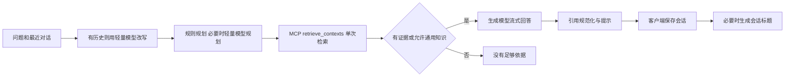
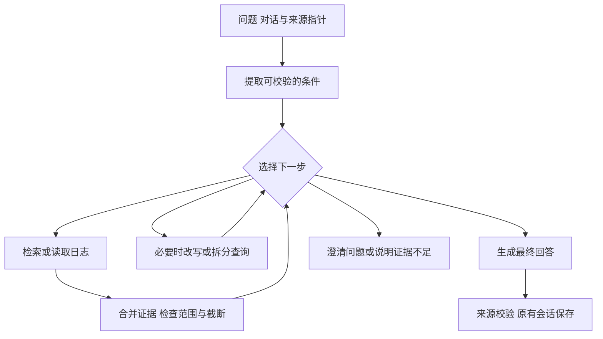

# 问答完整流程复查与 Agent 引入建议

后续状态：维护者已批准复用 AI SDK Core 的修订方案，实现、开关与实际比较结果见[实施记录](rag-agent-implementation-2026-10-11.md)。本文保留核查时的事实及方案，不再代表当前运行状态。

日期：2026-10-11。源码基线：`e0a1d92`。范围为公开版，不考虑 Wiki。

本文是源码核查、合成复现和技术方案，**不是已经接入 Agent 的交付记录**。本轮未修改运行代码，未调用付费模型，未发布、安装或访问真实学习资料。

## 结论

建议先修正检索条件和证据覆盖，再把一次性问答流程改为一个有明确边界的问答 Agent。它能够根据检索结果选择补查、读原文、澄清或回答。Jev 作为可替换的决策模型参与试验，生成模型负责查询改写和回答，代码负责日期、权限、预算和保存。

不是在现有流程前后都增加模型调用：新编排应替代现有固定的“改写→规划→一次检索”流程。保留现有入口、回答模式、来源跳转、流式输出和历史事务，各客户端继续共用服务端。

## 当前实际链路

已有基础：MCP 只读检索、关键词／可选向量与重排、来源定位、取消信号、流式完成校验、保存版本冲突与重复写入保护、失败保存重试。Agent 应复用这些实现。

主要入口：`study-log-web/lib/rag-query.ts`、`rag-planning.ts`、`rag-retrieval-plan.ts`、`mcp-client.ts`、`rag-answer.ts`、`rag-stream.ts`、`hooks/use-rag.ts`；检索实现位于 `study-log-mcp/src/retrieval.mjs`。

## 已复现的问题

以下均使用内存合成日志，不依赖模型输出。复现脚本见 [rag-agent-probe-2026-10-11.mjs](audits/rag-agent-probe-2026-10-11.mjs)。

| 优先级 | 输入／场景 | 当前结果及原因 | 应达到的行为 |
| --- | --- | --- | --- |
| P0 | 2026年9月的日志中哪里提到过 `Agent`？ | literal 分支提前返回，丢失月份条件；合成检索实际返回10月5日。 | 字面条件和日期条件同时生效；原文未命中不能把语义近似结果说成原文命中。 |
| P0 | 比较2026年9月和2026年10月的学习内容 | 只识别首个月，且 timeline_summary 优先于 comparison；只返回九月日志，语义规划被跳过。 | 表达两个比较范围，分别取证，明确两边的覆盖情况。 |
| P0 | 我记录过哪些关于2026年9月15日发布的模型的使用体验？ | 把发布日期直接当日志日期，限制只查当天，语义规划被跳过。 | 先识别日期在问题中的作用；仅明确的日志日期才能成为过滤条件。 |
| P1 | 总结有30天记录的九月 | 实际只返回9月11—30日共20条，context.truncated=true；该标志没有进入回答提示词。 | 覆盖范围可计算；分批补查／压缩，或明确回答只基于部分记录。不能暗示已经读完整月。 |

这些错误发生在回答模型看到资料之前，单纯更换回答模型无法补救。原有测试通过也不能证明这些组合已正确覆盖。

## 全流程中的优化空间

| 环节 | 源码证据和判断 | 建议 |
| --- | --- | --- |
| 提问与追问 | `use-rag` 只上传角色与正文，`parseRagHistory` 去掉旧引用编号；保留最近12条、每条6000字符、总计24000字符。指向“刚才第二条来源”的追问缺少稳定来源身份。 | 后续传递最小来源指针，由服务端重新校验、读取；不把旧回答当事实，也不复用旧 S1 编号作为全局身份。历史按完整轮次保留；摘要属后续优化。 |
| 查询改写与规划 | 有历史就改写；无日期的普通相关问题通常还要语义规划，两次调用串行。 | 明确的独立问题直接检索；决策判断是否确需改写／拆分。不把 Jev 再机械叠到每个步骤。 |
| 检索 | 问答只调用 retrieve_contexts。MCP 已有 list_months、list_days、get_day、search_logs 等工具，没有用于问答补查。 | 通过有限工具集合补查。单日精确问题可以直接读取；跨月比较分别检索；读取过长仍要报告截断。 |
| 证据判断 | 零结果直接结束；非零即回答。没有材料相关性、否定条件或比较覆盖的语义检查。 | 给 Agent 一个补查机会；代码检查覆盖，决策模型判断材料是否支持具体子问题。找不到不能等同于全库不存在。 |
| 截断与降级 | MCP 返回截断、重排状态；Web 仅保留部分运行信息，query 未把截断送入提示词，客户端也不接收 diagnostics。 | 保留覆盖／截断／降级摘要；用户只看必要提示，维护记录保留运行指标。Jev 的相关性评分不替代原有重排，先对照测量。 |
| 回答与引用 | 引用编号、格式及部分日期提示已处理；不是逐条语义蕴含检查。 | 首期先解决证据缺失。之后对有矛盾或条件的关键结论试验引用核对，不给每句话强加一次调用。 |
| 取消和异常 | 请求已传播 AbortSignal，流式中断不算完成，这是可复用的基础。 | Agent 所有工具与决策共享总截止时间；预算耗尽、取消、无新证据都能终止；模型失败回到修正后的基础路径。 |
| 保存与标题 | 历史保存有版本与 mutationId 保护；Web 的 save() 在保存回答后仍 await 自动标题，saving/busy 因此继续阻挡下一次提问。标题模型使用默认90秒超时。 | 回答保存成功后解除提问阻塞，标题异步更新继续验证会话版本；标题失败不应让问答看起来仍没完成。 |
| 运行恢复 | 当前 query 不持久化任务，客户端收完再保存。保存重试防重复写入，并不等于模型运行可恢复。 | 首期明确断线终止，不承诺恢复。只读 Agent 若需要跨断线继续，再引入 runId、检查点和生命周期；同一请求去重与会话 mutationId 分开。 |
| 用量与耗时 | 有阶段耗时，非流式 transport 只取正文，流式 usage 帧被忽略。没有完整实际用量账本。 | 记录各模型、各次调用的实际 usage；未知即未知。预算预留与真实扣费分栏，绝不能把预留累计当成已花费用。 |

## Agent 应替代什么

第一阶段只建设“日志问答 Agent”。系统根据问题和当前已读证据选择下一步，不要求用户额外挑工作流。

例：“比较九月和十月在数据库学习上的变化”。程序先校验两个月份；Agent 分别找相关记录，发现十月命中很少时可以换一个查询或读取已命中日的上下文；然后回答差异和仍缺的依据。不是先让模型写一份计划，之后仍然固定检索一次。

| 现有部分 | 处理方向 |
| --- | --- |
| contextualizeRagQuestion + 固定规划入口 | 替换为统一任务解析与下一步决策；简单问题走短路径，需要自由文本改写时才调用生成模型。 |
| 单次 retrieve_contexts | 替换为有上限的检索／读取循环，复用 MCP 实现。 |
| “非空即回答” | 改为覆盖检查和窄范围证据判断，允许补查、澄清或结束。 |
| 最终生成、来源规范化、会话保存 | 保留并接入新编排；不让决策模型直接操纵文件或覆盖历史。 |
| 其他 AI 功能 | 后续可把材料整理、重点标注、随记候选及分类建议作为统一整理任务的可选步骤；先做候选预览，再沿用原有显式应用。既有单功能入口保留。 |

第二阶段才考虑“整理材料→建议日志草稿／随记候选→检查重复→用户审阅”，以及“主题回顾→关联日志→建议收藏或分类”。不把保存、删除、备份恢复交给模型自主决定；也不在本轮加入后台常驻代理或自动批量改稿。

## Jev 的具体位置

Jev 返回 Choice、Score、Noul 等结构化判断，不负责生成回答；不同判断可以共享一份状态，但同一次请求的题目彼此独立，不能让第二题依赖第一题的答案。见 [官方介绍](https://docs.typesafe.ai/introduction)。

| 工作 | 适合的分工 |
| --- | --- |
| 查询是否依赖上文、属于查原文／总结／比较／需澄清 | Jev Choice/Noul 候选；简单确定条件先由代码处理。 |
| 候选片段是否涉及目标主题、是否明确支持一个子问题 | Jev Score 或 Choice。可把多个独立片段判断合批；输入保留条件与否定。 |
| 下一步选补查、读原文、澄清、回答还是停止 | Jev 从程序提供的可行动作中选择；运行器还要检查预算和前置条件。没有“足够证据”的确定值就保留不确定分支。 |
| 生成新的查询词、拆分复杂问题、写总结／解释 | 现有轻量模型或回答模型。Jev 可挑选已生成候选，不能凭空生成自由文本参数。 |
| 日期计算、总数、预算、版本和引用 ID | 代码。不能由任何模型代替确定性检查。 |

官方提供 [RAG 片段判别](https://docs.typesafe.ai/cookbooks/classifying_rag_passages)与[引用核对](https://docs.typesafe.ai/cookbooks/citation_check)示例，说明这些接入方式有依据，但不代表在中文学习日志上已经优于当前模型。

Jev 应通过独立 `DecisionProvider` 接入，候选实现为 Jev 和当前轻量模型的结构化判定。现有 `requestChat` 只处理聊天正文；Jev 使用独立的 [System One API](https://docs.typesafe.ai/api)，不能只把聊天模型名称换成 Jev。密钥留服务端；配置一次即可，日常无需用户选择多种 Agent 模式。

使用同一套封闭动作与响应校验；Jev 缺配置或失败时仍可用基础问答。保留最终生成模型，是否改用另一家决策服务由部署配置决定，不使 Jev 成为产品硬依赖。

须先测中文、否定与条件、选项顺序、无相关证据。官方说明英文表现更好，并建议按实际材料检查其他语言；固定经测试的模型版本，记录实际返回版本。见 [模型说明](https://docs.typesafe.ai/models)。概率／confidence 是决策信号，不是正确率证明，阈值由本项目样本确定，见 [置信度说明](https://docs.typesafe.ai/confidence)。

官方还明确提示数字、日期比较、复杂间接推理和对抗性内容的局限。程序只暴露有限只读工具，校验模型选择；检索到的正文不能改变工具权限或预算。见 [Jev 1.13 已知局限](https://docs.typesafe.ai/model-jaggedness/jev-1.13)。

## 搭建还是引入框架

| 路线 | 与本项目的匹配 | 建议 |
| --- | --- | --- |
| 现有 TypeScript 后端增加小型运行器 | 已有传输、MCP、取消、流式与事务；能直接接入非聊天式决策 API。需自己明确状态和终止条件。 | 首期推荐。只做当前问答需要的工具循环，避免建设通用 Agent 平台。 |
| Vercel AI SDK | 可管理工具循环、每步配置和停止条件；可减少以后多模型适配工作。Jev 仍需自定义决策适配，客户端 SSE 需保留兼容层。 | 做技术备选；若多提供方与标准工具调用成为主要需求，再小范围引入。见 [官方循环控制](https://ai-sdk.dev/docs/agents/loop-control)。 |
| LangGraph JS | 状态图、检查点适合长任务恢复与人工审批。引入持久化后有存储、清理和部署维护工作。 | 长期整理任务确实需要跨重启恢复时再考虑。内存检查点不等于持久恢复。见 [官方持久化说明](https://docs.langchain.com/oss/javascript/langgraph/persistence)。 |

以上是项目适配判断，不是性能排名；本轮没有安装这些框架。先用一个 Agent，不把查资料、评估、写答案拆成多个相互对话的 Agent。

## 首期实现边界

- 工具白名单：检索上下文、列日期、读指定日志、查字面原文。现有 get_day 有截断文本提示；需要更细的分页或小节读取时另补服务接口，不能假定已有。
- 内部证据以文件／日期／小节／内容哈希去重；多个工具各自的 S1 不能直接拼接。最终统一编号，再发送 sources 与 delta，避免流式中途改编号。
- 预算建议初值：最多3次决策、6次只读工具、1次自由文本改写、1次最终生成、整轮120秒；数字仅为起步试验参数。分阶段超时服从整轮余量，并限制总证据长度、生成输出和最大费用。超额返回有边界的结果，不无限补查。
- 同一工具与参数的重复调用停止；证据没有新增则停止。上下文因日志变化失效时重新校验，不混入旧版本。显式日期和“仅依据日志”不能被模型擅自放宽。
- 不自动把“日志＋通用知识”当作外网搜索授权；首期没有浏览网页工具。
- Jev SDK 若有默认重试，必须纳入统一预算；不可每层都各自重试。不同模型调用的 input/output usage 与耗时分开记录。
- 使用现有 status/sources/delta/done/error 输出，首期不向旧客户端直接新增必需事件。原生客户端现有解析器不一定容忍未知事件。进度仅显示“补充查找十月记录”等必要动作，不输出内部推理。
- 可选语义引用复核如果需要改正文，应发生在定稿前，不能先显示未经复核的结论再悄悄替换。首期不默认增加逐句复核。

## 推进顺序与验收

1. **基础修正**：日期与字面条件组合、多时间范围、事件日期区分、截断／覆盖信息、标题生成解除阻塞。把本轮探针转成期待正确行为的回归测试；不靠 Agent 隐藏这些问题。
2. **可重复评测**：准备40—60个合成中文问题，覆盖技术概念、排错、读书、否定条件、跨期比较、追问、无证据、长月、引用与取消。标注目标日期、必需来源、可回答范围；开发集与留出集分开。
3. **只读 Agent 原型**：先以模型替身跑通动作、取消、预算、去重和来源编号；再对比修正后的单次检索、轻量模型决策、Jev 决策三条路径，使用相同资料和最终回答模型。
4. **有限真实模型试验**：单独记录授权上限与实际消费。衡量范围正确率、证据召回、比较两侧覆盖、错误自信回答、引用支持度、平均与P95延迟、每题实际费用；不以多调用了工具作为改进指标。
5. **选择性启用**：只有复杂问题确实获益才走多步流程，简单问题保留短路径。建议门槛：本轮确定性缺陷全部修复、留出集范围与引用表现不退化、复杂问题有可重复收益；时延和费用上限在试验前登记。未达标保留原流程，不强推 Jev。
6. **后续整理 Agent**：问答成立后再接候选草稿／分类审核，复用显式应用和现有写入事务。跨重启恢复、长期记忆、定时任务不随原型默认加入。

## 本轮检查记录

- Web RAG 相关测试79项通过。
- MCP测试50项：49通过、1跳过。跳过为 Windows 文件符号链接权限，目录 junction 用例已执行。
- 4个合成探针复现本报告问题；未用真实日志或付费模型。
- 历史事务、取消和流式协议以源码与既有测试核查；本轮没有重新运行各客户端界面、实际模型质量或故障断线设备测试。
- 当前仅形成方案，尚未实现 Agent 或修复本表缺陷。
