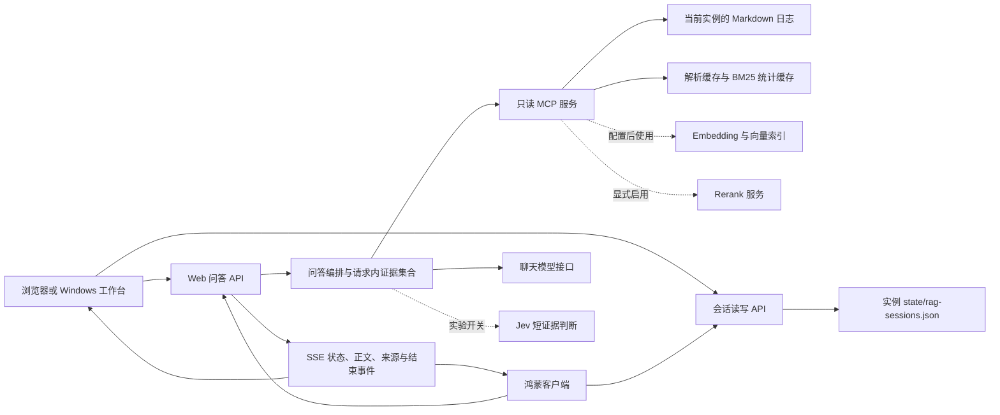
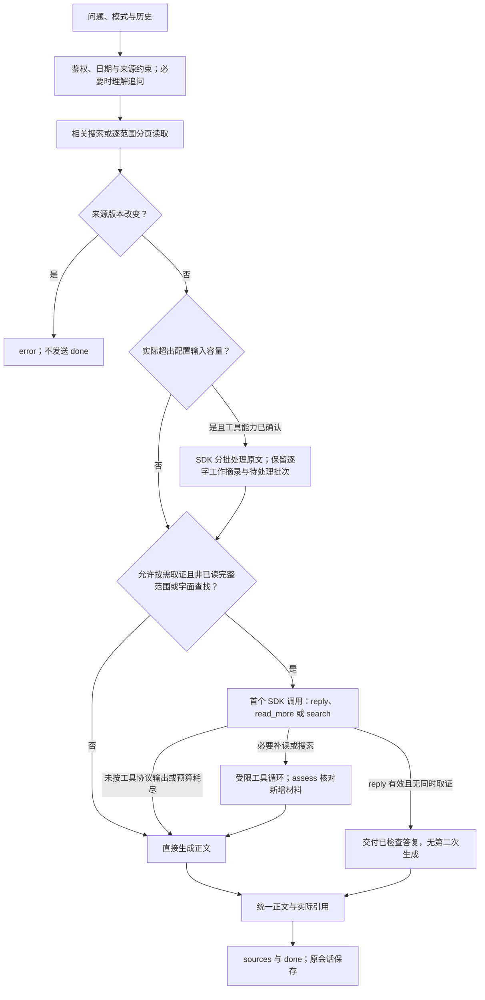
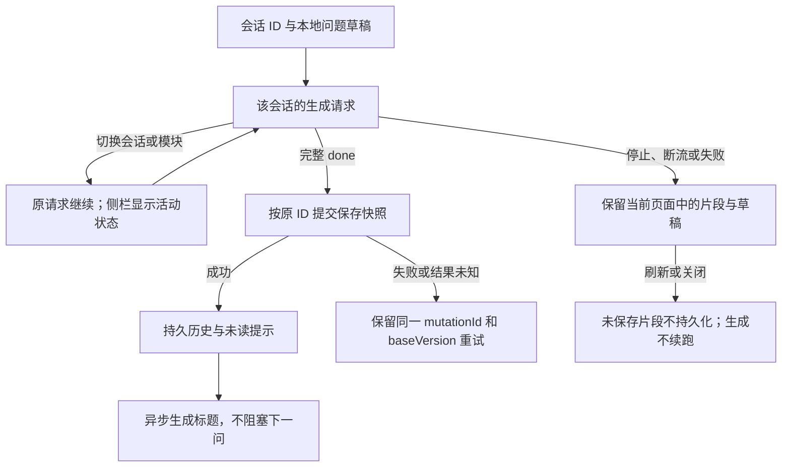

# 当前日志问答整体架构

更新日期：2026-10-16，适用于通用版 v0.1.1。

当前问答不为每个问题另做一次入口分类。相关检索取得材料后，同一个 SDK 调用在三个互斥动作中选择：材料足够时用 `reply` 直接交付，已命中来源但缺少必要正文时用 `read_more`，尚未命中线索时用 `search`。只有后两种动作或超出已声明输入容量的分批处理，才记为实际进入 Agent。补查后由 `assess` 归纳材料支持、条件与剩余缺口，再交给统一正文通道。两个能力开关、两步 SDK、八次 MCP 与整轮限时保持。

此前已补齐 SDK 步骤间的补查请求状态。三个省略已有材料实质归纳的隔离候选未通过宽泛问题对照，未采用；当时保留的完整 `answer` 提交现已由上述协议替换。旧对照仍作为失败与成本记录保留。

本次继续修正了完整范围内“没有已保存日志”与“未完成读取”的区分，并让同模型的问答辅助请求沿用显式思考设置；未增加调用阶段。另两处生成表述错误没有已证实的通用修法，保留问题而不追加提示词补丁，见[排查与验证](rag-evidence-completion-2026-10-15.md#后续排查表述边界与等待)。

2026-10-15 已修正实验 Agent 的取证结束与来源输入，见[原因、改动和对照结果](rag-evidence-completion-2026-10-15.md)。后续已将已知来源的补读统一到回答缺口，删除直接 `read` 与摘录失真触发读取的重复入口。充分材料与必要补读的固定重复、其他主题对照已通过，并完成开启 Agent 的八会话十五轮回放；宽泛问题的补读必要性和等待仍需按实际结果判断。

此前的[固定问答验收](rag-round-acceptance-2026-10-15.md)已形成日常回放、候选弃用和能力边界结论；没有改变下述正式链路或默认开关。日常核心任务可用，不代表来源表达、Agent 补查及长材料综合已经全面可靠。

## 1. 架构概览

当前问答默认使用 RAG：系统先检索日志，再根据原文生成带来源的回答。开启 Agent 后，模型可以根据已有材料继续搜索或读取相关日志。日期范围、读取权限、引用和会话保存仍由代码控制。

| 状态 | 能力 | 使用条件与限制 |
| --- | --- | --- |
| 已落地：默认问答 | 日期与字面条件解析、追问理解、检索规划、相关检索、范围分页读取、证据管理、回答与引用、会话保存 | 配置聊天模型与 MCP 后使用 |
| 已落地：可选检索 | Embedding 向量索引、关键词与向量融合、rerank | 单独配置服务；未配置或失败时使用关键词检索 |
| 已落地：Web／Windows 会话管理 | 多会话后台生成、跨模块切换、独立停止、保存重试、未读提示、异步标题 | 工作台页面保持打开时有效 |
| 已落地：能力确认后的按需 Agent | 首步直接答复、读取已命中来源、换词搜索、补查后材料判断 | 不单独调用入口裁判；总开关默认允许，仍须显式确认模型工具能力 |
| 实验中：可通过开关使用 | 短证据 Jev 判断、范围末状态核对 | 默认关闭，尚未达到常规启用的质量标准 |
| 已实现，效果仍待完善 | 超出输入上限时分批选择逐字原文摘录 | 长材料的关键信息保留与回答质量仍需验证 |
| 未完成 | 可靠的长范围综合、超上下文材料的分层综合、跨刷新／重启续跑 | 相关原型未接入正式流程 |

下文的默认行为均指未设置可选开关时的实现；具体实例以其配置为准。

## 2. 组件与数据流

- **Web 服务**负责鉴权、请求编排、模型调用、证据与引用处理，以及会话读写。
- **MCP 服务**从配置的实例目录读取日志，返回原文、元数据和读取范围。问答使用 `retrieve_contexts` 与 `read_log_range` 两个工具。
- **AI SDK Core**管理可选 Agent 的模型与工具调用循环。普通规划、摘录和最终回答沿用项目现有的模型传输代码。
- **Markdown 文件**是原始资料，缓存和向量索引可由原文重建。当前问答只检索日志，不检索随记、Wiki 或外网。
- **Windows 本地模式**运行随包附带的 Web／MCP；连接服务器时，与网页、鸿蒙共用服务器后端。客户端会话能力的差异见第 8 节。

## 3. 请求流程

SDK 可以在工具返回后继续决策，最多执行两步。取得新证据后，系统再次检查输入大小、读取范围和原文版本。取消会传递到正在执行的检索与模型请求。范围读取全部失败时直接报错，部分失败时说明缺失范围；读取期间原文发生变化则终止整轮。

### 3.1 问题理解与范围确定

规则规划器将问题分为相关性检索（`relevance`）、时间线总结（`timeline_summary`）和比较（`comparison`），同时解析日期范围、离散月份／日期与字面条件。用户明确给出的范围优先于模型改写；“整月＋单日”会分别读取两边。明确日期中存在无效项时，系统提示修正日期。事件发生或发布的日期与日志日期分别处理。

`prepareRagQuery` 统一处理来源指针、当前条件、追问范围及规划回退，主编排只使用其最终结果。有历史消息、且用户未明确指向某条来源时，轻量模型在同一次调用中返回独立查询、`scopeSource` 和 `strategy`。`scopeSource` 指出沿用哪条历史用户问题的范围；`strategy` 按实际语义选择相关检索、时间线总结或比较，不再从改写文本的关键词重新分类，也不再追加一次规划调用。策略缺失或不在允许集合中时返回 `RAG_CONTEXT_UNCERTAIN`。

代码从选定历史问题重新解析日期，当前问题的新条件优先；模型不能新增日期或字面匹配字段。精确查找仍强制相关检索，避免模型把它改为范围回顾。历史中使用“上个月”等相对日期、又缺少消息时间时，系统要求补充日期。策略校验只检查取值，不证明模型理解正确。

精确匹配需要原文位置询问或明确的查找动作，主题名称、引号或“工具的定位”等名词本身不构成字面条件。未识别为精确查找的表达仍可进行相关性检索。

首次提问带总结、回顾或比较等意图，而规则仍不能确定计划时，系统沿用轻量模型辅助规划；已有明确范围则直接使用。追问理解失败时沿用原有澄清或安全规则回退，不再尝试第二个规划请求。因此，默认 RAG 的模型调用数仍会随问题变化。本次合并不等于所有首次提问都经过模型路由；首问的规则仍可能把术语中的动作词误当作任务意图，此边界尚未修正。

“刚才第二条来源”通过最近助手消息的可选 `sourceRefs` 定位，再读取最新原文。指针缺失或与当前日期条件冲突时，系统要求澄清；历史哈希只用于来源识别。

### 3.2 检索与范围读取

| 问题类型 | 读取方式 | 结果范围 |
| --- | --- | --- |
| 具体概念、机制、相关主题 | 日期过滤后的 `retrieve_contexts` | 返回相关片段 |
| 字面查找 | 按原字面条件检索 | 无命中时保留空结果 |
| 有起止日期的总结／比较 | 对每个范围分页 `read_log_range` | 返回总日数、已完整读取日期与下一页游标 |
| 只有主题而没有完整日期范围 | 可能使用相关检索 | 返回命中的相关内容，未必覆盖全部日志 |

范围游标绑定日期集合与原文版本 `revision`。下一页发现来源改变时，MCP 的 `SOURCE_CHANGED` 映射为 `MCP_SOURCE_CHANGED`，上层停止回答。旧 MCP 缺少范围工具时返回读取错误。

## 4. 检索、索引与缓存

日志按日块和 Markdown 小节拆分，过长小节再分片。日期、月份、文件名、标题位置、片段身份与内容哈希随结果返回，供过滤、去重、引用和回到原文使用。

默认关键词检索对中文分词，并使用标题与正文的 BM25 评分排序。配置 Embedding 后，系统计算向量余弦相似度，再用 RRF 融合关键词与向量排名。可选 rerank 对相关性检索的有限候选重排，失败时保留已有结果。向量索引保存在本地文件中，无需外部向量数据库。

| 缓存／索引 | 保存与失效方式 | 每次查询仍需执行 |
| --- | --- | --- |
| 文件解析缓存 | MCP 进程内保存每个文件的原文与解析结果；内容改变后重新解析 | 安全读取文件、比较内容并检查跨文件重复日期 |
| BM25 统计缓存 | 缓存最近一组语料，按片段 ID、标题和正文指纹失效 | 查询分词与评分；日期筛选改变语料时可能重建统计 |
| 向量索引 | 存于 `INDEX_ROOT/index-v3.json`，按实例身份、模型、接口指纹、维度、切分版本与内容复用向量 | 计算查询向量，检查并同步片段索引 |

未配置 Embedding、索引不可用或服务失败时使用关键词检索；取消请求则停止处理。BM25 缓存位于进程内，向量索引在检索时同步，均没有独立后台索引任务。单个索引文件的更新串行执行；不同进程应使用独立索引目录。

## 5. 证据、输入容量与引用

`EvidenceRun` 在请求期间管理已取得的原文，统一分配 `S1…Sn` 编号并去重。它记录已读日期、完整／部分／空／失败等读取状态，以及截断和停止原因。范围读取结果、提供给模型的摘录、答案最终使用的引用分别记录。

完整枚举、已读数量一致且来源版本未变时，程序按日期边界计算 `unrecordedDayCount`：该范围没有已保存日志的日历日期数。这与读取失败或遗漏不同，也不表示当天没有学习。搜索、未读完、日期边界不全或来源改变时为 `null`，不推断没有记录；原文截断或摘录造成的细节缺失仍单独报告。该信息仅供服务端生成使用，不改变客户端协议或保存格式。

最终输入容量包含内部材料判断及剩余缺口，不把它们当作免费附加上下文。最终生成与 SDK 使用同一份 `modelContexts()` 原文视图，只有证明同版本且确实包含的旧片段才隐藏；登记身份不删除，无法证明包含关系的拼接片段仍保留。

工具能力已确认且声明上下文窗口的路径使用 `planRagMaterial` 检查真实输入容量。能容纳的原文直接提供，不因搜索截断而自动分批。超限才由 `processRagMaterial` 将原文完整规划为连续分片，SDK 选择摘录、下一批或复看；明确范围回顾不能把尚未提供的批次当成已处理。最多四次材料步骤，与整轮 120 秒期限共享，达到上限时保留未处理状态。

原始 `contexts`、内容哈希及读取覆盖不改写；`material` 单独保存模型工作视图。模型增量提交当前批的逐字摘录，以编号移除不再需要的旧摘录，代码保留其余内容并去重。工作记忆超限时保留已接受内容，在同一预算内反馈调整；格式、来源或输出截断失败则停止。最终生成只接收已核对摘录，不把工作判断当成原文。新取得的短证据能与旧工作材料共同容纳时，直接加入，不重新处理全部旧原文。

窗口未知、工具能力未确认或明确关闭时仍保留 `compactEvidence` 兼容路径：选择较长来源的逐字摘录，失败时截取并标记受限。它仍修改该请求的证据副本；不能把新工作材料路径的隔离性质算到这条兼容路径上。两条路径共用容量计算，不以模型名称猜测窗口。

配置 `RAG_CONTEXT_WINDOW_TOKENS` 后，系统用 UTF-8 字节数保守估算输入大小，扣除提示开销、65,536 输出余量和 32,768 协议余量。未配置时，证据正文上限为 30,000 字符。该算法未使用模型 tokenizer；预留量用于控制输入大小，不是实际输出量或付费额度，窗口值应按模型已核实能力填写。

生成结束后，系统规范正文和引用编号，发送答案实际引用的来源；未知或缺失引用会给出提示。用户可沿来源查看原文。

## 6. Agent 与 Jev

### Agent：按需取证与超限材料处理

`RAG_AGENT_TOOL_CALLING_VERIFIED=true` 仍是能力前提；`RAG_AGENT_ENABLED` 未设置或为 true 时允许按需运行，false 明确关闭，其他值不启用。新实例写入允许按需运行、能力尚未确认的配置；不自动改变已有实例的 false，也不付费探测模型。启用与供应商、模型名称无关。

相关性请求的首个 SDK 调用只提供 `reply`、`read_more` 和 `search`。`reply` 提交答复及原文锚点，格式与来源通过检查且没有同时取证时直接交付，不另做一次正文生成。`read_more` 只能请求读取已登记来源中尚未提供的正文，`search` 才用于尚未命中的具体线索。它们不是独立入口裁判。只有执行读取、搜索或分批处理时，诊断 `agent.entered` 才为 true。

完整范围已读且材料容纳得下、或字面查找，继续直接生成。超限材料按上一节进入分批处理；它与动态补查属于不同需求，不能把固定分页本身称为 Agent。

Agent 使用主聊天模型和 AI SDK 的 `streamText` 工具循环。补查后的步骤提供 `search` 和 `assess`；`assess` 提交四项内容：

- `assessment`：已有材料如何支持所问要点，以及适用条件、关系或矛盾的简短归纳；不是面向用户的完整答复。
- `evidence`：核对判断所需的来源和逐字锚点。
- `unresolved`：尚不能说明的要点及已知来源；这份列表本身不授权读取。
- `next`：`finish` 结束取证，保留剩余缺口供最终回答说明；`read` 仅对当前问题必需、且仍可读取的已知来源执行补读。未知来源、非法身份或没有缺口说明的 `read` 被拒绝；已知来源因先前已读而无法再读时，保留判断与缺口、结束补查，不把它变成格式错误。

日期由程序从来源登记确定，不暴露另一套直接 `read` 入口。搜索保留最终检索计划的日期和字面条件。上述判断使用现有 SDK 调用，不另加 Jev、规划或判断模型。

取证阶段单独使用当前覆盖状态与剩余预算，不再套用最终回答的材料不足指令。工具返回后，系统用当前证据重建输入；同一版本完整日块包含旧小节片段时，来源登记保留，但模型只看到完整日块。旧编号只有经相同文件、日期、版本、小节及内容包含关系确认后，才能归到该日块，不能映射未知来源或其他版本。

重建输入时，`previousEvidenceRequests` 保留上一组全部补查请求：搜索词、所缺要点及实际返回的来源；读取则保留缺口、实际尝试的日期及新增或恢复的来源编号。同日多个缺口仍合并为一次读取，并行搜索各自登记结果，空结果不占用其他查询的新增来源。状态在整组工具完成后统一交给下一步，不累积完整工具消息或候选正文；缺口描述是模型先前的判断，不代表程序确认它仍未解决。该状态替换原来只有最后一项的 `lastTool`，不进入客户端或会话历史。

`assess` 的来源检查分清三件事：所有引用与缺口必须指向本轮已登记且提供的来源；模型主动提交的每条 `evidence` 摘录都必须与其所指正文、标题或日期逐字核对；语义上每个论断是否成立仍需评价，不能由复制一句原文来证明。因此不要求答案里的每条引用都额外提交一段摘录，也不会因摘录失真自动触发读取。未知来源或任一失真摘录都会拒绝，来源版本保护保持。

已知来源仍有明确缺口且允许补读时，先读取再进入下一步；同一步同时提交材料判断和搜索时，旧判断不能直接交给最终生成。官方 DeepSeek Flash 显式关闭思考时使用已实测支持的强制工具选择；Pro 没有同等能力证据，开启思考及其他兼容模型也继续使用自动工具选择。自动模式下若模型直接输出普通文本，该文本不向用户发布，系统回到现有正文生成路径，不把协议偏离当成整轮问答失败。无新增材料、普通工具失败或达到预算时，也由原有生成路径说明已读范围。

执行结果区分 `answered`、`assessed` 与 `needs_answer`：`answered` 是首步经检查的直接答复；其余结果中，前者携带可核对的材料判断和剩余缺口，后者表示未形成有效判断、需按现有材料生成。两者均使用现有最终回答通道，正文按 delta 显示；材料判断仅作为待核对的组织线索，不是新增来源或事实证明。`evidence_assessed` 不代表材料完整或答案已经生成。内部工具消息、判断与锚点不写入会话历史。

直接答复只有首个 SDK 调用，整组完成前缓冲；它不在工具参数尚未校验时输出片段。补查仍最多两次 SDK 决策及一次最终生成，追问理解另计；真正超出已声明输入容量时，材料步骤最多四次，之后保留未处理状态。所有路径共享整轮 120 秒和八次 MCP 边界。

### Jev：短证据判断，默认关闭

Jev 仅在上述 Agent 分支内、额外设置 `RAG_JEV_ENABLED=true` 且凭据可用时尝试。问题最多 240 字符、最多 4 条证据、正文合计最多 2,400 字符；超出则跳过。

它判断两件事：材料是否足以回答所问要点，以及是否与问题前提冲突。结果为 `supported + absent` 时跳过 SDK 补查，由主模型生成答案；其余结果进入工具循环。未配置、调用失败或结果校验失败时，也继续原有流程。调用限时 8 秒、零重试，关闭正文调试日志，并随整轮请求取消。

Jev 可通过 TypeSafe 直连或 Vercel 适配调用，职责限于补查前的短证据判断。日期与跨月范围解析、工具权限和最终答案处理由其他模块负责。

### 范围末状态核对：独立实验，默认关闭

设置 `RAG_STATUS_VERIFICATION_ENABLED=true` 后，完整读到至少 14 个日块的时间线总结可执行这一步。系统先生成草稿，再抽取关于所选范围末尾状态的断言，例如某个问题是否仍未解决，并用原主模型核对。缺少支持的断言从结果中移除；没有此类断言时直接输出草稿，核对失败时附上提示。这一步会缓冲正文并增加模型调用，与 Jev 独立。

## 7. 流式协议、诊断与失败

入口为 `POST /study-log/api/rag/query`，请求含 `question`、`mode` 和可选 `history`。`logs_only` 仅依据日志作答，`logs_and_general` 允许另列通用知识补充。后者使用模型已有知识，不调用外网搜索。历史输入受消息数和字符数限制，保留可用的来源指针。

| SSE 事件 | 含义 |
| --- | --- |
| `status` | 简短阶段进度，不发布内部推理 |
| `delta` | 回答正文增量；部分路径缓冲后输出 |
| `sources` | 当前最终选定的来源；可能晚于正文 |
| `done` | 完整结果、最终 citations 和 diagnostics；客户端以此确认成功 |
| `error` | 安全错误码、提示与可用诊断；失败后没有成功 `done` |

客户端以 `done.citations` 为最终来源，只在收到完整 `done` 后保存成功回答。EOF、停止、错误和内容过滤保留为未完成状态。仅依据日志而没有证据时，普通路径直接返回说明，省去最终回答调用；日期无效等需要澄清的情况也通过 `done` 返回说明。

诊断记录各阶段耗时、首正文时间、读取范围、工具次数、Agent 停止原因与模型用量。SDK 按供应商请求分别记录用量：同一请求的后续有效计数替换旧值，多次请求再累计。缺失字段保持未知，取消或失败前已收到的值继续保留；失败后停止读流。费用核对仍以供应商账单为准。

请求上限如下；触及上限时，回答按已有材料说明缺失范围。

| 边界 | 当前值 |
| --- | --- |
| 问题／请求体 | 1–2,000 字符／128 KiB |
| 整轮请求 | 120 秒，覆盖辅助调用、取证和生成 |
| 证据读取预算 | 累计最多 8 次 MCP 取证调用，含初始取证；单次范围页最多 30,000 字符 |
| 搜索默认返回 | 最多 8 个上下文、12,000 字符；接口硬上限 20 个、30,000 字符 |
| 原文保留／来源 | 最多 240,000 字符／160 个来源，来源上限贯穿输出、客户端与保存 |
| SDK 循环 | 最多 2 步；模型步骤数与 MCP 调用次数分别计数 |
| 普通回答流 | 单次默认 90 秒且受整轮取消约束；正文最多 120,000 字符 |

重复查询、无新增证据、非法读取日期、工具失败、版本变化及预算耗尽会触发停止处理。鉴权、限流和网络异常保留各自的错误分类。

## 8. 后台会话与持久化

Web 的共享 `Workspace` 通过 `useRag` 管理请求。每个会话在 Map 中独立保存消息、草稿、模式、AbortController、生成／保存状态、错误和重试快照。切换模块时这些状态继续保留。同一会话忙碌时禁止重复提交，其他会话可以生成。

会话存于 `LOG_ROOT/state/rag-sessions.json`，通过写入队列、临时文件、同步落盘与原子替换保存。`baseVersion` 用于检查并发修改，`mutationId` 与内容指纹识别同一次保存，避免重试产生重复记录。读取到损坏文件时报错并保留原文件。异步标题只合并已知的标题版本变化，其他修改仍需通过版本检查。

会话加载错误单独保存，重试继续读取用户选择的目标。后台保存只更新所属会话，用户当前所在页面保持不变。登录失效时取消活动请求并保留本页草稿；主动退出前检查全部未保存会话。输入框聚焦期间保持显示，避免 WebKit 自动滚动打断输入。

后台生成依赖工作台页面保持打开。刷新后可重新读取已保存历史，未完成的生成和未保存片段不会恢复。鸿蒙使用同一后端协议；本节的多会话 Map 与侧栏活动状态属于 Web／Windows 实现，鸿蒙对应能力尚待单独核对。

## 9. 配置

| 配置 | 职责／默认行为 |
| --- | --- |
| `CHAT_API_URL`、`CHAT_MODEL`、`CHAT_API_KEY` | 主模型接口、模型名和凭据；URL 使用完整地址，保留路径与查询参数 |
| `CHAT_LIGHT_MODEL` | 轻量理解、规划、摘录、标题等辅助任务；未设时沿用主模型名和同一接口配置 |
| `STUDY_LOG_MCP_URL`、`STUDY_LOG_MCP_TOKEN` | 显式检索地址和 Bearer 鉴权，无默认远程实例 |
| `RAG_CONTEXT_WINDOW_TOKENS` | 已核实的模型上下文窗口；未设置时按第 5 节的字符上限处理 |
| `RAG_AGENT_ENABLED` ＋ `RAG_AGENT_TOOL_CALLING_VERIFIED` | 前者默认允许按需运行、false 关闭；后者必须显式确认工具能力 |
| `RAG_JEV_ENABLED`、`RAG_JEV_PROVIDER` | 独立可选判断；provider 默认 typesafe，可选 vercel，凭据分别从私有环境读取 |
| `RAG_STATUS_VERIFICATION_ENABLED` | 独立范围末状态核对，默认关闭 |
| MCP 的 Embedding／Rerank 配置 | 各自管理向量化、维度和重排能力；未配置不阻止关键词检索 |
| `RAG_DEEPSEEK_THINKING` | 仅对代码明确支持的官方接口和模型应用可选参数；未设沿用提供方默认行为 |

项目使用兼容接口配置模型。DeepSeek 思考模式是可选的供应商适配，作用于主回答与 SDK 调用；问答中的理解、规划和摘录使用同一模型时也沿用该显式设置。独立配置的轻量模型、会话标题及其他 AI 功能保持原参数；未设置时仍沿用提供方默认值。分析耗时时需分别查看各阶段的模型和参数。

## 10. 已知限制与未完成部分

已有自动化检查覆盖日期范围、MCP 分页、版本变化、取消、用量、引用和会话生命周期。模型质量另行评估：已具备无需额外入口裁判的直接回答出口、动态补查和独立工作材料路径；能力未确认仍使用兼容 RAG。真实会话回放不等于全部质量达标，Jev 仍没有设为必经组件的依据；长材料对照出现输出和工作记忆超限，正在修正和复核。具体测试和交付记录见文末链接。

| 项目 | 当前限制 |
| --- | --- |
| 回答与引用的可靠性 | 来源和格式检查不检查每个结论是否被原文支持；模型仍可能误解或过度推断 |
| 按需补查与等待 | 当前不另做入口分类，简单问题通常一次直接交付；需要补查时正文须等取证结束。模型仍可能把非必要信息判断为缺口，来源与轮数边界只能限制影响，不能证明决策总是最优 |
| 整月／跨月综合 | 仍可能混淆历史问题与范围末状态，或把不同事项归到一起 |
| 超上下文材料处理 | 新路径隔离原文与工作记忆，保留未处理批次；真实长材料的收益、覆盖与耗时仍须对照，不把兼容输入上限等同模型原生窗口 |
| 多批草稿再综合、事项关系预处理 | 原型试验遇到超时或草稿校验失败，未接入正式流程 |
| Jev 的适用范围 | 只用于短证据判断；结构与概率校验无法判断其语义是否正确，尚无设为必经步骤的依据 |
| 跨重启恢复 | 没有服务端任务队列、检查点和恢复机制；尚未引入 LangGraph 或 Mastra |
| 鸿蒙后台多会话 | 对应实现和设备行为仍需单独核对 |

后续评估分别关注检索覆盖、输入信息保留、回答准确性与等待时间。真实模型试验的结论限于所用模型、参数和材料；旧试验中因预算过严而提前压缩的样本，也需要按修正后的输入上限重新判断。

本阶段变更及实验边界见[按需问答实施记录](rag-on-demand-2026-10-15.md)。既有失败草稿和关系预处理没有重新接入；当前分批流程只保留逐字证据，模型判断不作为新增来源。

## 11. 源码与相关文档

| 责任 | 当前源码 |
| --- | --- |
| API 与总编排 | [query/route.ts](../study-log-web/app/api/rag/query/route.ts)、[rag-query.ts](../study-log-web/lib/rag-query.ts) |
| 日期、策略与追问范围 | [rag-retrieval-plan.ts](../study-log-web/lib/rag-retrieval-plan.ts)、[rag-planning.ts](../study-log-web/lib/rag-planning.ts) |
| MCP 边界与请求内证据 | [mcp-client.ts](../study-log-web/lib/mcp-client.ts)、[rag-evidence.ts](../study-log-web/lib/rag-evidence.ts) |
| Agent、判断与摘录 | [rag-agent.ts](../study-log-web/lib/rag-agent.ts)、[rag-jev.ts](../study-log-web/lib/rag-jev.ts)、[rag-evidence-summary.ts](../study-log-web/lib/rag-evidence-summary.ts)、[rag-status-verifier.ts](../study-log-web/lib/rag-status-verifier.ts) |
| 回答协议、引用与配置 | [rag-answer.ts](../study-log-web/lib/rag-answer.ts)、[rag-stream.ts](../study-log-web/lib/rag-stream.ts)、[ai-config.ts](../study-log-web/lib/ai-config.ts) |
| 会话与前端状态 | [rag-sessions-store.ts](../study-log-web/lib/rag-sessions-store.ts)、[use-rag.ts](../study-log-web/hooks/use-rag.ts)、[Workspace.tsx](../study-log-web/components/Workspace.tsx)、[RagWorkspace.tsx](../study-log-web/components/RagWorkspace.tsx) |
| 检索与索引 | [log-store.mjs](../study-log-mcp/src/log-store.mjs)、[retrieval.mjs](../study-log-mcp/src/retrieval.mjs)、[retrieval-core.mjs](../study-log-mcp/src/retrieval-core.mjs)、[vector-index.mjs](../study-log-mcp/src/vector-index.mjs)、[range-reader.mjs](../study-log-mcp/src/range-reader.mjs) |

配置与协议细节见[日志问答接口说明](rag.md)，架构演进和试验过程见[目标架构与试验依据](rag-target-architecture-2026-10-11.md)。测试与交付记录包括[日期与失败修复](rag-audit-fixes-2026-10-14.md)、[解析与 BM25 缓存](rag-retrieval-cache-2026-10-13.md)、[后台会话](rag-background-2026-10-12.md)、[生命周期复核](rag-session-lifecycle-2026-10-15.md)及[0.1.1 补发记录](release-0.1.1-2026-10-15.md)。历史记录中的配置以本页当前说明为准。
