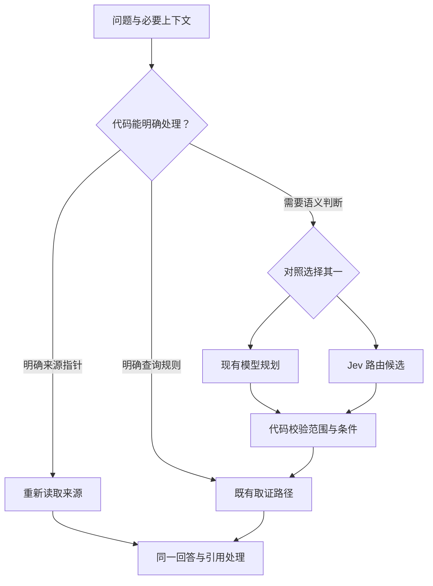

# Jev 路由职责与首轮筛选

本轮先判断是否值得引入，未修改应用问答流程，也未启用任何实验开关。Jev候选职责是替代已有的意图规划，不是新增证据复核层。来源指针、日期计算、读取、预算和保存继续由代码管理。

## 最小候选流程

图中Jev尚未接入。失败的候选测试不触发更多模型调用或正式改造。本轮仅筛选路由决策，尚未执行图中的完整双路回答对照；补查Agent和Jev证据判断均不参与。常规来源追问已有代码处理，即便Jev能识别，也不构成增加调用的理由。

## 固定测试条件

调用前固定14条中文问题和期望路由，覆盖搜索、单日/多日汇总、跨期比较、概念比较、事件日期、混合日期、追问、新话题及否定条件。只发送合成问题和一句必要上下文，不读取用户日志。

单次请求并列判断两项：取证类型与日期角色。没有日期计算、长文理解或答案生成。使用现有官方SDK与 `jev-1.13.0`，关闭调试正文日志、重试，单次8秒SDK超时/10秒调用信号。第二遍只反转选项顺序；没有看到答案后改提示词。共28次，错误即停止；实际全部返回且结构校验通过。

这符合官方建议的有限选择、明确选项及顺序敏感性检查；日期运算不交给模型。[官方使用边界](https://docs.typesafe.ai/model-jaggedness/jev-1.13)

## 结果

| 观察 | 结果 |
| --- | --- |
| 完全匹配预设两项标签 | 第一遍11/14，反转顺序后10/14；仅为小样本标签匹配，不能当作产品准确率。 |
| 明确跨月比较、用“变化”表达的跨月比较 | 两遍都选对comparison，但把日志时间选成events。如果据此删除日期条件，会漏掉用户范围。 |
| 概念比较 | 第一遍comparison，第二遍search；存在顺序敏感性。 |
| 事件日期题“我如何理解……那项技术” | 两遍均clarify，预设search。此题确有“那项技术”指代不明的问题，澄清也合理，不能直接算模型错误；保留原始评分，不事后改标签美化结果。 |
| 混合日期、否定比较 | 两遍标签均符合预设，但标签正确不代表已经选出正确日期文本片段，不能直接据此执行。 |
| 时间及用量 | 每次290—711毫秒，均值约331毫秒；22872输入token、2920输出token。不是端到端问答耗时，也不是供应商账单。 |

私有运行记录：`.local/jev-routing-live-20261011`，含调用前固定样本、规则观察及逐次结果。密钥仅在进程环境中使用，未写入文件。脚本为 `study-log-web/scripts/rag-routing-experiment.mjs`；默认只观察规则，显式 `--live` 才请求TypeSafe，输出目录必须是新的绝对路径。

## 现有流程也有问题

源码及规则探针确认以下现状，不能用它们证明Jev更优：

- “九月和十月的做法有什么变化”被规则选为相关性搜索，并因已有日期不再进入语义规划，不能保证逐期读取。
- “不用比较九月和十月，只总结十月”仍选比较，并保留被排除的九月范围。
- 中文月份描述的发布事件未被现有事件日期正则剔除；“提到”里的“到”还可能被月份连接判断当成区间连接符。
- 规划函数允许模型处理的情况，外层调用入口不一定放行；本轮规则报告区分了函数条件与无历史入口条件。追问改写及真实现有规划模型未在本轮调用，因此不把规则结果称为完整普通RAG对照。

## 决定

不把这版Jev两项路由接入正式路径，也不继续消耗最终生成调用做下游比较。跨月日期角色与选项顺序尚不稳定；同时新增日期角色标签仍需要文本范围对应，盲目落地会增加复杂度。

后续优先修复已定位的规则和入口问题，保持一个规划位置。若仍有确实需要模型判断的案例，再比较现有规划模型与更窄的Jev职责，例如只选择“搜索/范围汇总/比较”，让代码负责明确日期；那需要新样本及完整对照，不能沿用本次成绩宣布有效。不因本轮结果否定Jev所有用途，也不为保留组件而追加多层复核。

本批仅增加实验脚本、固定样本和文档，结果结构校验测试通过；应用运行代码未变，无需重新打包安装。未发布、推送或改写学习记录。
