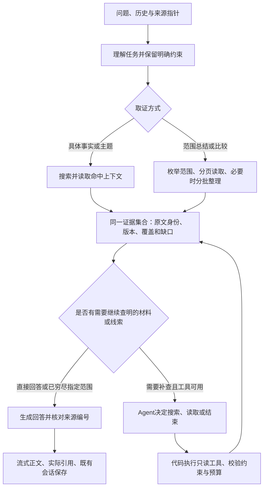

# 问答目标架构与验证依据

本页定义后续工作的目标，不把已有实验接入视为目标已完成。此前“最终核对”仅证明阶段性实现与检查，不能据此宣布整个问答优化结束。

## 2026-10-13 复盘后的推进顺序

暂停继续排列提示词、输出格式和模型参数变体，先用已有请求、响应和源码区分失败所在阶段。此调整保留整项目标，不把范围总结从验收中移除，也不以总结尚未通过否定已经观察到的补查收益。

1. **取证与工具执行**：检查实际提供了哪些原文、身份和条件，模型是否沿缺失线索补查。继续使用当前 AI SDK 与共享证据集合；不新增必经判断器或第二套运行框架。
2. **材料压缩**：先核对容量、摘录及回退造成的信息损失。已经确认批次预排后没有检查实际缩减量，会在材料已经放得下时继续压缩；现改为每批前重新检查，保留尚未处理的原文。逐字校验通过仍不代表重要信息完整，不能以来源编号和日期齐全证明摘要忠实。
3. **答案综合**：在完整材料已经提供时，混淆项目、阶段或把旧问题延续至今属于综合失败。主题归组、结构化格式和“最后记录日”都不是语义正确的证明。先标明原文依据和具体错误，再确定需要修改的材料组织或综合步骤；不继续堆叠提示词掩盖责任。
4. **体验与调用**：分开记录首字、完整回答、取证和生成耗时。单次模型调用也可能长时间没有正文；流式协议存在不代表用户及时看到回答。内部工具决定和中间推理继续留在服务端。

下一次真实模型对照之前，必须固定一个候选及其假设、对照输入、预期收益和停止标准。已有题目用于诊断，另留未参与调参的材料检验泛化；保持同一模型和正式参数映射，一次只改变一个因素。先做可离线回放的确定性修复，不为证据已经足够的结论重复付费。真实材料和派生评审只留在忽略目录，不写入本页或其他版本管理文件。

摘录所属小节已做离线复核：必须检查最终拼接内容，不能只检查单段是否携带三级标题。前段已保留标题、后段仍属于同一小节时，归属并未丢失；现有成功摘录未发现拼接后的归属变化。合成反例表明，省略跨小节标题确实可能造成错误归属，但这是边界风险，不能据此解释已观察到的错答。本轮不因此增加归属判断模型、元数据层或新的提示词。

下一步先整理答案综合的离线评审依据，再决定候选实现：

- 每条争议结论对照其支持原文、后续相关原文和模型实际收到的内容，分别标记“材料未提供”“压缩遗漏”“已提供但理解错误”；没有后续状态依据时保留未知，不以最后记录日期代替状态判断。
- 区分“历史上出现过的问题”“范围末仍未解决的问题”和“后续已处理的问题”。记录问题所问的时间口径，不把一般知识按新旧覆盖。
- 先审核评审本身：答案另一段已经覆盖的内容不能算遗漏，摘录前段已有标题不能算丢失归属，格式检查通过不能算语义正确。
- 将现有题目作为诊断集，冻结原始输入、模型参数和基线；另留未参与修改的材料。只有找到能由明确改动解决的失败类型后，才确定一个对照候选，不能同时更换模型、提示词、分组与输出格式。

这个顺序不意味着为每个问题增加审查调用。具体问答继续依靠现有检索与有界补查；完整范围已读到却综合错误，应在材料整理和回答职责内解决。暂不把强制结构化输出、按标题归组或增加思考强度作为正式修复，它们尚未同时证明正确性与响应速度。

逐条离线复核已确认：部分回答在收到相关前后原文后，仍把已处理的问题写成现存问题、移动项目启动阶段，或给处理办法附加未完成状态。正确对照也包含相同的缺陷词语，但明确限定为历史并写出后续处理。因此不能用关键词替换答案，也不能用“没有后续记录”自动推导已解决或未解决。实际问题、引用位置与输入哈希留在忽略目录；这些旧题只用于诊断。

本轮候选为**范围总结中的事件及前后关系整理**，已完成隔离原型、十一项合成离线检查及首组真实对照，现因执行与等待表现不合格而不采用。原假设是：先明确同一事项的历史状态、后续处理及无法确定的部分，再自然语言综合，比只按标题归组更能减少状态混淆。以下为试验前确定的边界，不是已通过的能力：

- 只针对需要跨日期综合的总结或比较，不替换检索，不给普通事实问答增加调用；不新增运行框架或必经 Jev 判断。
- 原文位置、日期、来源身份由代码核对；事项是否相同、后续是否真正处理了先前问题仍是语义判断，不能冒充确定性校验。整理结果不能新增来源、把未知状态变成确定状态，或删除条件与否定。
- 首先在隔离原型中检查来源核对、取消和错误处理。真实对照固定原文、最终模型与参数，仅比较有无这一步；保留全部原文，避免同时改变压缩或取证。这样只能验证综合职责，不能称为超上下文验收。
- 若需要额外模型调用，完整计入首字等待、总耗时、用量和失败率。只有旧题及独立材料上的状态、日期和来源表现改善，且等待时间可接受，才考虑进入产品；不能只凭输出格式合法、一次正确或低费用采用。
- 长材料仍另行验证压缩是否保留事件关系。完整上下文下的候选成功，不代表分批后仍成立；两项都通过才算范围综合目标完成。

隔离原型复用已有非流式和流式传输：范围任务先提出带逐字引文的事项关系，再使用原模型、原参数和全部原文作答；普通相关性问答跳过整理。代码检查引文唯一位置、所属小节、记录日期先后及引用身份，不生成“已解决”状态，也不把空关系视为“仍未解决”。两阶段共享取消与整轮时限，错误不悄悄降级为成功候选；内部整理不流入用户正文。离线检查使用模型替身，仅证明边界、原文保留及取消传播，不能证明语义收益或真实耗时。候选、对照请求和独立材料的评审依据已在真实调用前冻结。

真实对照已在调用前冻结候选哈希、完整原文、最终模型与参数，以及独立材料的评审要求；未改变检索、压缩或模型。首组基线约 40.9 秒完成、首字约 30.7 秒；候选整理阶段约 90 秒超时，尚未进入最终回答。供应商随后返回用量，24,000 个输出 token 全为推理，正文为空并以 length 结束；不能解释成复制引文过长，也不能评定其事项关系正确与否。额外整理未通过预定等待标准，已停止，不执行独立材料、不提高上限继续尝试，正式路径不引入该步骤。本次两个请求的用量计价上界约 0.3182 元，不是供应商账单。这个失败不能推翻已有短问题补查收益，也不代表长范围目标已经完成。

随后回查旧实验与实际入口，未发现这批已明确日期、无历史的范围问题额外执行语义规划：规划器已有规则直通，完整范围读完后也会跳过补查 Agent。此前表格化简短回答约 49.9 秒完成、45.0 秒首字，仍有状态表述问题；更小输出上限曾在思考期间耗尽，不能算无依据回答。汇总已有供应商用量后，开启思考的多组单次调用主要输出为推理 token，关闭思考虽更快但未通过既有质量评审。这些记录的输入和参数并非完全一致，只用于定位与避免重复试验，不能据此给模型作普遍排名。不能把这批生成等待转嫁为检索或前端问题，也不继续用更短格式、更多预处理或更高上限盲试。维护者已明确继续只用 DeepSeek，不扩展其他供应商或采用 Pro 作为绕过方案；当前模型、默认开关和生产流程保持不变。后续先核对评审中的事实矛盾与含糊表述，不能把带日期的历史处理过程一律判为范围末仍未解决。现有最终回答提示已经要求区分历史与当前状态，因此不得仅以缺少时间规则为由重复追加提示。先固定已确认的错误与独立材料，再选择一个有明确假设的改动；不恢复已否决的额外事项整理调用，也不同时更换分组、输出格式和思考参数。

继续限定 DeepSeek 后，完成此前冻结且未执行的独立材料单次生成检查。Flash 非思考基线约 8.4 秒完成、0.7 秒出现正文，主要事实与条件保留，但末段将设计梳理列为已实现能力。保持原文、问题、模型与参数，仅追加完成程度区分规则的隔离候选约 7.2 秒完成、0.7 秒出现正文，保留既定事实并区分设计、原型和测试结果，单例语义检查通过。两次调用用量计价上界约 0.055 元，非供应商账单；耗时差异没有重复样本，不能宣称速度提升。该候选随后保持不变接受整月错误场景检查，未接入正式提示。此前额外事项关系调用仍不采用；本次没有工具循环或新判断器，不代表范围综合、Agent 或超上下文验收通过。实际资料及评审留在忽略目录。

固定候选的整月对照未通过：非思考基线约 9.3 秒、候选约 8.6 秒完成，首字均约 0.6 秒，但两者仍把已有后续恢复依据的早期问题列为当前待解决；候选还出现事项归属错误。已核对两边实际问题与原文完全相同，系统提示只差该规则，关键前后原文均已提供；这不是单凭历史措辞判错。两次调用用量计价上界约 0.100 元，非账单。短材料单例通过不足以支持采用，现停止这条候选，不调另一种措辞补救。下一诊断保留相同事实问题与模型，只比较直接相关原文和加入其他材料后的表现，用于定位状态推理与材料干扰的边界；不将诊断结果直接视为产品修复或降低整月覆盖要求。

材料干扰诊断已保持问题、模型、参数及系统规则一致，仅比较直接相关原文和完整月份原文。两个回答都正确区分早期缺陷与后续恢复，分别约 1.3 秒和 2.3 秒完成；两次用量计价上界约 0.041 元。这一单例不支持把整月综合错误简单归因于原文字数，也不能证明不存在其他材料干扰。结合整月任务的明确错误，下一假设转为多事项综合职责：按 Markdown 结构保留同标题的完整时间序列，分范围整理后再整体回答。先做隔离原型和来源、完整重组检查，再固定模型、材料、调用上限与停止标准比较实际收益；不增加必经判断器，不给普通事实问答增加阶段。此方案不同于此前只重排输入的一次调用，但仍未实施或证明有效，不能把分主题本身视为已解决综合错误。

分范围综合隔离原型已完成九项合成检查：按 Markdown 小节保留完整原文与时间顺序，两批草稿只引用各自实际来源，最终回答仍提供全部原文；普通事实问答一次直答，失败、取消和共享时限停止后续调用。真实月份的三十份来源、十二个主题可完整重组为两批，原型最多两次草稿及一次最终生成。冻结候选的真实调用在第一批约 26 秒后因草稿校验失败停止，6,605 个输出 token，最终生成未开始；仅执行一次，用量计价上界约 0.077 元。已停止该候选，不执行独立样本或调整输出限制继续跑。非流式响应正文未留存，无法确定具体违规项，也不能评判草稿事实质量；实验驱动已补未来响应留存，没有为补记录重跑。这证明工程边界与真实执行仍有差距，不代表分范围综合思想被否定，更不是长材料或整体目标通过。

实际调用链补查确认：思考配置目前只作用于主回答与 SDK 工具循环，轻量追问理解、规划和压缩保留供应商默认参数，这是已记录的设置边界。一次固定已有对话的追问改写对照中，默认约 4.5 秒，非思考约 0.9 秒；两者保留对象与问题，但后者遗漏上一轮明确的日期范围。当前规划器据默认改写生成该月范围，据非思考改写没有日期限制；此差异不能以格式正确或耗时降低忽略。两次用量计价上界约 0.007 元。尚未向轻量任务传播设置，下一步先检查继承范围的处理与测试覆盖，不扩大到其他模块或另加规划模型。本项是单组函数调用与当前规划器核对，不代表实际入口、所有追问或全任务耗时验收。

长材料继续遵循“放得下一次生成，放不下才分批”的目标。是否调整逐源摘录为按任务组织的分批综合，须由信息损失审计决定；尚未实施或证明收益。两轮工具决定、八次 MCP 和整轮 120 秒边界不变。Agent 补查、范围综合分别验收，全部目标仍需在日常问答路径成立后才能宣布完成。

开源参考继续采用 [AI SDK 循环控制](https://ai-sdk.dev/docs/agents/loop-control)；[LlamaIndex 的答案综合职责](https://developers.llamaindex.ai/python/framework/module_guides/querying/response_synthesizers/)用于比较直接、逐步和树状综合的取舍，不因此引入另一套运行库。Jev 尚无进入必经路径的证据，保持可选且默认关闭。

2026-10-13 长范围工程检查补充超过 120,000 字符的双月资料，发现并修复原文在分批整理前提前丢弃日期的问题。保留容量与既有八次 MCP、每次最多 30,000 字符的预算对齐；不扩大调用或时间限制。实际取证与分批链路保留全部 35 天及条件/否定，提取失败仍说明材料缺口。此前较短的跨月测试不足以证明这一边界；本项证明数据流，不代替真实模型或整体启用验收。

2026-10-12 较新实现：SDK 每轮均可直接回答，补读后的第二轮不再强制另起最终生成；来源上限已在流解析与会话保存间统一，材料压缩先检查实际上下文预算。正式路由已有显式主模型思考模式，默认行为不变。模型效果验收须使用正式参数映射，不再让测试代理替产品设置思考模式；预算和测试输出长度限制单独披露。较低延迟不代表补查正确，配置组合必须同时通过充分材料、缺少具体依据、范围总结与比较的对照，未通过前不更改默认模型或实验开关。真实资料及其派生质量记录仅存于忽略目录，不随实现文档提交。

2026-10-13 超上下文工程检查新增实际双月分页与分批提取链路，包含日块在分页边界拆分、每个日期的条件/否定、最终来源对应及提取失败状态。模型替身按固定规则摘录和作答，只用于确认数据流；真实模型能否正确选择与理解内容，仍须独立验收。已知范围的多批处理复用普通取证路径，不为超长本身再增加 Agent 判断调用。

2026-10-12 当前进展：SDK 首轮在同一次输出中回答或说明具体缺口，只有后者进入补查；长材料分片保留明确的小节归属，工具选择兼容思考模式。两类材料出现重复收益，尚有摘要忠实性、完整重复及耗时问题，默认仍关闭。详见[实现与逐组结果](rag-answer-first-2026-10-12.md)。

## 用户得到的结果

一个问答入口，继续使用“仅依据日志／日志＋通用知识”。用户不需要选择RAG或Agent。具体问题尽快回答；指定范围读全再整理；需要沿线索才能回答的问题由Agent补查。没有依据、资料不完整、服务失败分别说明，不混为“没有记录”。

图中的缺口判断是职责，首期不额外增加一个必经“判断模型”。代码识别覆盖、截断和工具资格；需要语义决定时由取证Agent选择动作或finish。Jev暂不进入正式链路，不在规划、路由、取证上重复叠加分类器。

## 职责和边界

- 普通RAG是基础取证能力，Agent调用同一搜索/读取与证据管理。不能另建一套引用、日期规则或存储。
- 代码负责明确日期、字面约束、来源身份、权限、版本、分页、范围差集、预算与停止。Agent不能扩大用户明确指定的范围。
- 模型负责必要的指代理解、语义规划、多步取证决策、分批内容整理与最终表述。服务端的工具消息不进入用户正文和聊天历史。
- 长材料不自动等于Agent任务。已知范围的材料超出输入预算时分批整理；只有下一步查哪里取决于读到的内容时才需要自适应取证。
- 初次搜索没命中不能证明全库没有记录。Agent可以有界换词；没有新线索或读完指定范围仍缺依据就结束，不编造、不无限搜索。
- 保留两轮工具决策、累计八次MCP读取、120秒及上下文限制。达到上限时只能报告实际范围；多跳任务超过当前能力是部分结果，不能冒充完整完成。
- 模型未知工具能力时走普通RAG并准确说明读取限制；鉴权、限流和网络错误仍是错误，不能当成“不支持工具”。

## 当前差距与首轮检查

初次核对 `rag-query.ts`、`rag-planning.ts` 和 `rag-agent.ts` 时，入口依赖comparison、空结果或“为什么／如何／关联／矛盾／变化”这些表达。后续已移除措辞门槛，但真实模型沿具名线索取得完整条件仍不稳定，实验开关保持关闭。入口修正不能当作目标完成，见[对照记录](rag-entry-wording-2026-10-11.md)。

本次复跑29项相关检查全部通过：实际MCP、SDK工具循环及失败/取消、31天范围、长材料沿线索读取、摘要容量、共享日版本变化后停止。它们证明现有部件的协议与数据流，未证明新入口或默认Agent质量。

## 面向目标的验证

| 场景 | 必须观察的结果 |
| --- | --- |
| 具体事实，初次上下文足够 | 正确回答及来源；无需额外多轮查找。记录调用和耗时。 |
| 明确月份总结、双月比较 | 全范围枚举，两边均有覆盖；长材料分批，条件/否定与来源保留，无重复补查。 |
| 同一多步问题换三种说法，其中不用现有触发词 | 均能读取被截断原文，并沿其中的具名线索查到所需规则；不能只让“为什么”版本成功。 |
| 新技术、排错、读书材料，初次取证确实缺少具名依据 | Agent取得基线缺失的依据；正确条件与引用。提前记录基线是否已有答案，不人为隐藏材料制造收益。 |
| 已有足够资料的对照材料 | Agent正确结束；不能靠重复读取增加来源和调用。 |
| 空范围、无命中、无更多线索 | 正确区分确定空范围与本次未找到；没有虚构因果或全库穷尽声明。 |
| 来源追问、明确日期/字面限制、读途中修改 | 约束不被改写/工具突破，版本变化拒绝混合；旧客户端仍可用。 |
| 工具失败、取消、超时/次数/容量上限 | 停止真实请求，保留草稿，说明部分结果或错误，不发布虚假的完整回答。 |

顺序：先用本机模型替身与实际MCP验证入口/边界；修正有证据的差距；再用预先固定、不同材料的中文问题做有限付费对照，两条路径最终模型相同。逐题核对依据、范围、条件/否定、引用、调用、用量与时间，不用“跑完”代替答案正确。

启用要求：新入口在常见措辞上正确选择；不同多步材料有可重复收益；简单问题和完整范围没有明显退化；原有取消、来源与会话流程仍通过。只启用通过的边界，未通过的任务明确保留限制。最终完成要求是这些目标在日常问答路径实际成立，而不是实验目录内能够调用Agent。

已固定完整合成语料、七组问题的两次重复及逐条原文依据，共 28 个回答；追加预算后已执行对照，但未达到默认启用标准。原判定与停止条件见[重复对照依据](rag-repeat-gates-2026-10-12.md)，后续结果如下。

2026-10-12 后续执行：维护者已追加10元，重复对照及三种停止判断试验未达整体启用门槛，未证明收益的实现已回退。隔离“同一次首轮回答指出缺口，必要时再补查”原型展示短题一调用的可能性，仍需在修正中文名称与分页状态的基线上验证。不是新的默认架构或额外必经判断模型，见[证据与剩余工作](rag-routing-trials-2026-10-12.md)。
