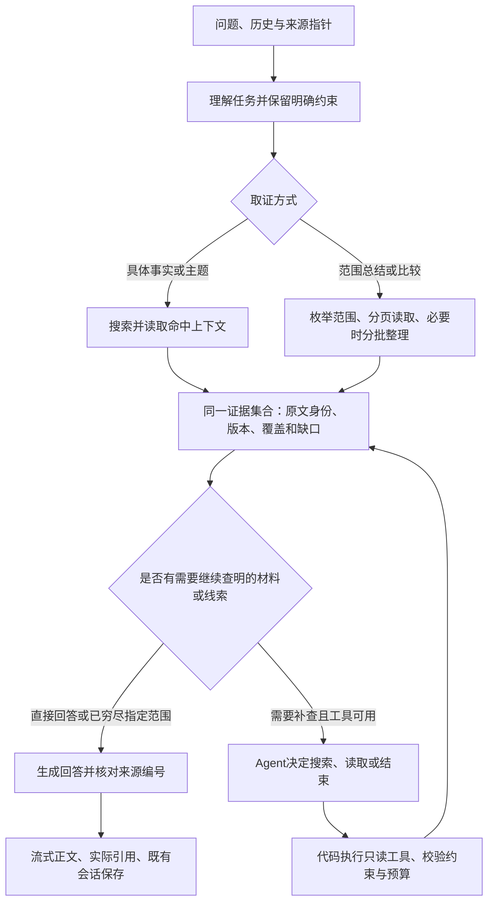

# 问答目标架构与验证依据

本页定义后续工作的目标，不把已有实验接入视为目标已完成。此前“最终核对”仅证明阶段性实现与检查，不能据此宣布整个问答优化结束。

## 用户得到的结果

一个问答入口，继续使用“仅依据日志／日志＋通用知识”。用户不需要选择RAG或Agent。具体问题尽快回答；指定范围读全再整理；需要沿线索才能回答的问题由Agent补查。没有依据、资料不完整、服务失败分别说明，不混为“没有记录”。

图中的缺口判断是职责，首期不额外增加一个必经“判断模型”。代码识别覆盖、截断和工具资格；需要语义决定时由取证Agent选择动作或finish。Jev暂不进入正式链路，不在规划、路由、取证上重复叠加分类器。

## 职责和边界

- 普通RAG是基础取证能力，Agent调用同一搜索/读取与证据管理。不能另建一套引用、日期规则或存储。
- 代码负责明确日期、字面约束、来源身份、权限、版本、分页、范围差集、预算与停止。Agent不能扩大用户明确指定的范围。
- 模型负责必要的指代理解、语义规划、多步取证决策、分批内容整理与最终表述。服务端的工具消息不进入用户正文和聊天历史。
- 长材料不自动等于Agent任务。已知范围的材料超出输入预算时分批整理；只有下一步查哪里取决于读到的内容时才需要自适应取证。
- 初次搜索没命中不能证明全库没有记录。Agent可以有界换词；没有新线索或读完指定范围仍缺依据就结束，不编造、不无限搜索。
- 保留两轮工具决策、累计八次MCP读取、120秒及上下文限制。达到上限时只能报告实际范围；多跳任务超过当前能力是部分结果，不能冒充完整完成。
- 模型未知工具能力时走普通RAG并准确说明读取限制；鉴权、限流和网络错误仍是错误，不能当成“不支持工具”。

## 当前差距与首轮检查

初次核对 `rag-query.ts`、`rag-planning.ts` 和 `rag-agent.ts` 时，入口依赖comparison、空结果或“为什么／如何／关联／矛盾／变化”这些表达。后续已移除措辞门槛，但真实模型沿具名线索取得完整条件仍不稳定，实验开关保持关闭。入口修正不能当作目标完成，见[对照记录](rag-entry-wording-2026-10-11.md)。

本次复跑29项相关检查全部通过：实际MCP、SDK工具循环及失败/取消、31天范围、长材料沿线索读取、摘要容量、共享日版本变化后停止。它们证明现有部件的协议与数据流，未证明新入口或默认Agent质量。

## 面向目标的验证

| 场景 | 必须观察的结果 |
| --- | --- |
| 具体事实，初次上下文足够 | 正确回答及来源；无需额外多轮查找。记录调用和耗时。 |
| 明确月份总结、双月比较 | 全范围枚举，两边均有覆盖；长材料分批，条件/否定与来源保留，无重复补查。 |
| 同一多步问题换三种说法，其中不用现有触发词 | 均能读取被截断原文，并沿其中的具名线索查到所需规则；不能只让“为什么”版本成功。 |
| 新技术、排错、读书材料，初次取证确实缺少具名依据 | Agent取得基线缺失的依据；正确条件与引用。提前记录基线是否已有答案，不人为隐藏材料制造收益。 |
| 已有足够资料的对照材料 | Agent正确结束；不能靠重复读取增加来源和调用。 |
| 空范围、无命中、无更多线索 | 正确区分确定空范围与本次未找到；没有虚构因果或全库穷尽声明。 |
| 来源追问、明确日期/字面限制、读途中修改 | 约束不被改写/工具突破，版本变化拒绝混合；旧客户端仍可用。 |
| 工具失败、取消、超时/次数/容量上限 | 停止真实请求，保留草稿，说明部分结果或错误，不发布虚假的完整回答。 |

顺序：先用本机模型替身与实际MCP验证入口/边界；修正有证据的差距；再用预先固定、不同材料的中文问题做有限付费对照，两条路径最终模型相同。逐题核对依据、范围、条件/否定、引用、调用、用量与时间，不用“跑完”代替答案正确。

启用要求：新入口在常见措辞上正确选择；不同多步材料有可重复收益；简单问题和完整范围没有明显退化；原有取消、来源与会话流程仍通过。只启用通过的边界，未通过的任务明确保留限制。最终完成要求是这些目标在日常问答路径实际成立，而不是实验目录内能够调用Agent。

下一轮已固定完整合成语料、七组问题的两次重复及逐条原文依据，共 28 个回答；尚未发起模型请求。执行前需解决追加试验预算，具体判定与停止条件见[重复对照依据](rag-repeat-gates-2026-10-12.md)。
